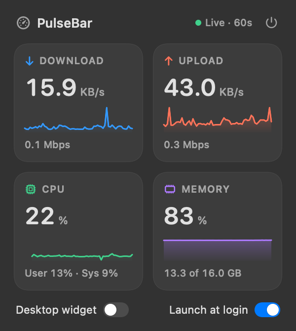
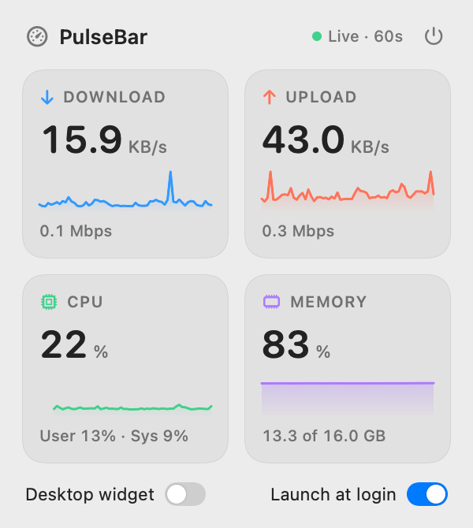
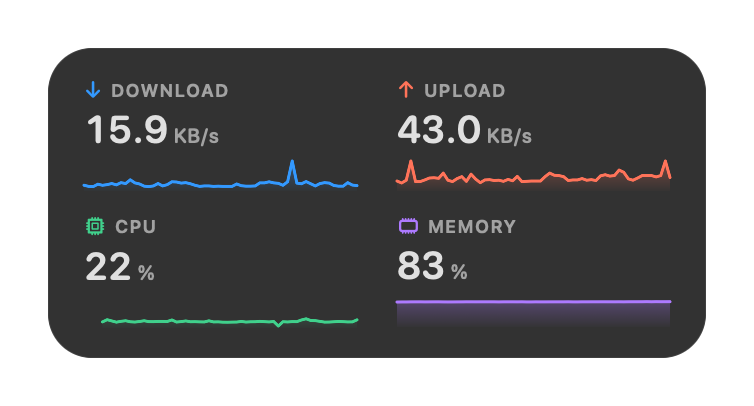
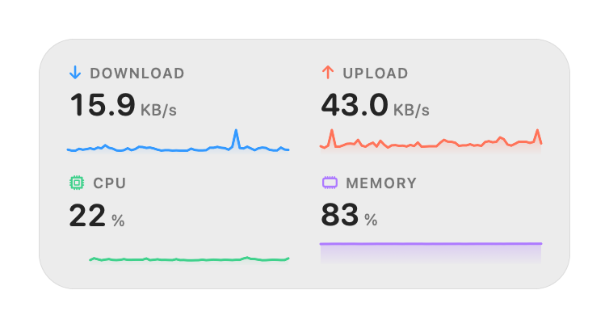

# PulseBar

A tiny, native macOS menu bar app. Click the gauge icon to see live **download / upload speed**, **CPU** and **memory** in one small panel.

<p align="center">
  
  &nbsp;
  
</p>

- **Native and light:** Swift + SwiftUI, no Electron, no runtime. ~360 KB download, ~15 MB memory, ~0.1% CPU while idle.
- **Glanceable:** just an icon in the menu bar. Click it for the panel with 60-second sparklines.
- **Desktop widget:** optionally pin a live, widget-sized panel to your desktop (updates every second).
- **Launch at login:** on by default, one switch to turn it off.
- **Private:** makes no network requests of its own and collects nothing. It only reads the counters macOS already keeps.
- **Universal:** Apple Silicon and Intel, macOS 13 Ventura or later.

## Desktop widget

<p align="center">
  
  
</p>

Turn on **Desktop widget** in the panel. It sits on your desktop behind all windows, on every Space, and updates every second.

- **Move it:** drag it anywhere; the position is remembered.
- **Hide it:** right-click → Hide Desktop Widget, or switch it off in the panel.

Why not a native macOS widget (Edit Widgets)? WidgetKit widgets are refreshed by macOS on its own schedule, roughly every 15–60 minutes, so they can't show live network speed.

## Install

```sh
npx pulsebar
```

This copies `PulseBar.app` to `~/Applications` and launches it. Run the same command again to update.

| Command | What it does |
|---|---|
| `npx pulsebar` | Install or update, then launch |
| `npx pulsebar uninstall` | Quit, remove the login item, delete the app and its preferences |
| `npx pulsebar start` / `stop` | Launch / quit the installed app |

**Without npm:** download `PulseBar.zip` from [Releases](https://github.com/shisodiaashutosh/pulsebar/releases), unzip, and move `PulseBar.app` to Applications. The app is open source and ad-hoc signed, not notarized by Apple, so macOS blocks a browser-downloaded copy the first time. Clear the download flag once:

```sh
xattr -dr com.apple.quarantine /Applications/PulseBar.app
```

(Installing with `npx` skips this step.)

## How the numbers are measured

Every value is read straight from the kernel once per second; no helper processes, no shelling out to `top` or `netstat`.

| Metric | Source | Matches |
|---|---|---|
| Download / Upload | 64-bit interface byte counters from `sysctl(NET_RT_IFLIST2)`, summed over physical `en*` interfaces | `netstat -ib` |
| CPU | `host_statistics(HOST_CPU_LOAD_INFO)`: tick deltas across all cores | `top` |
| Memory | `host_statistics64(HOST_VM_INFO64)`: app memory + wired + compressed | Activity Monitor's "Memory Used" |

Notes:

- **Why 64-bit counters:** the common `getifaddrs` counters are 32-bit and wrap every 4 GB, which produces bogus spikes on fast connections.
- **Why only `en*` interfaces:** with a VPN on, the same traffic shows up twice, once on the tunnel (`utun*`) and again, encrypted, on Wi-Fi/Ethernet. Counting physical interfaces only gives the real speed on the wire.
- Speeds use decimal units (1 MB/s = 1,000,000 bytes/s); the caption shows the same value in Mbps, the unit speed tests use.

## Build from source

Needs only the Xcode Command Line Tools (`xcode-select --install`); full Xcode is not required.

```sh
npm run build:dev    # native arch only, fast
npm run build        # universal (arm64 + x86_64) → dist/PulseBar.app and dist/PulseBar.zip
npm start            # open dist/PulseBar.app
```

Debug flags on the app binary (`dist/PulseBar.app/Contents/MacOS/PulseBar`):

| Flag | Purpose |
|---|---|
| `--print [seconds]` | Print one sample per second to the terminal, no UI |
| `--status` | Print the version and launch-at-login status |
| `--show-panel` | Open the panel right after launch |
| `--snapshot out.png [light\|dark] [--seconds N] [--widget]` | Sample for N seconds and render the panel (or the desktop widget) to a PNG (used for the screenshots above) |

### Project layout

```
Sources/
  Samplers.swift     CPU, memory and network readers (Darwin / Mach APIs)
  StatsModel.swift   1 s timer, 60-sample history, formatting
  PopoverView.swift  The panel (SwiftUI)
  DesktopWidget.swift  The desktop widget window and its view
  AppDelegate.swift  Menu bar icon + popover
  LoginItem.swift    Launch at login (SMAppService)
  main.swift         Entry point and debug flags
Resources/Info.plist Bundle metadata (LSUIElement = no Dock icon)
Resources/AppIcon.icns  App icon, generated by scripts/make-icon.swift
scripts/build.sh     swiftc → universal binary → .app → ad-hoc sign → zip
scripts/make-icon.swift  Draws the icon in code and packs AppIcon.icns (`swift scripts/make-icon.swift`)
bin/cli.js           The `npx pulsebar` installer
```

## Releasing

1. Bump `version` in `package.json` and commit.
2. Tag and push: `git tag v0.2.0 && git push origin v0.2.0`.
3. The [release workflow](.github/workflows/release.yml) builds the universal app on a macOS runner, attaches `PulseBar.zip` to a GitHub Release, and publishes to npm.

One-time setup: on npmjs.com, open the package → **Settings → Trusted Publisher → GitHub Actions**, and enter
owner `shisodiaashutosh`, repository `pulsebar`, workflow `release.yml`. No npm token is stored in GitHub.

## License

[MIT](LICENSE)
